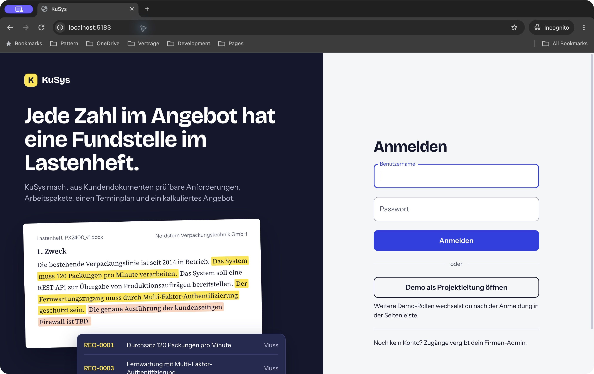

# KuSys 1.0

KuSys transforms customer documents into traceable requirements, engineering work packages, a resource-leveled schedule with critical-path analysis, and versioned quotations with requirement-level budget and price impact.

The normative functional source is `KuSys_Rebuild_Spec.md`.

## Application preview



The screenshot shows the local sign-in page with synthetic example requirements, without customer data or credentials.

## Product workflow

1. Upload PDF, DOCX, or PNG customer documents.
2. Extract text/tables and run OCR where required.
3. Review, normalize, classify, exclude or edit source sections; approve a review revision.
4. Configure a cloud model and run the CrewAI engineering workflow to derive requirements, clarifications, work packages and traceability. Technical derivation requires valid provider credentials; there is no rule-based fallback.
5. Maintain requirement budgets, relations, revisions and non-destructive impact/what-if analyses.
6. Maintain work packages, dependencies, rate card, role/FTE capacity and calendar.
7. Calculate resource leveling, schedule, float and critical path.
8. Build multiple offer variants/scopes; calculate cost, sales price, risk, discount, VAT, margin, budget deviations and requirement attribution.
9. Release with four-eyes approval. The exact baseline/calculation/template is frozen and an immutable DOCX is generated.
10. Export DOCX/XLSX; publish immutable artifacts to the customer portal.

## Architecture

KuSys is a modular monolith with separate runtime processes:

- React/TypeScript frontend behind Nginx
- FastAPI API
- Celery worker
- Celery beat scheduler
- isolated CrewAI runtime for engineering agents
- PostgreSQL
- Redis
- local filesystem artifact storage behind an adapter

The backend code is organized by domain (`auth`, `documents`, `review`, `analysis`, `requirements`, `planning`, `pricing`, `offers`, `templates`, `artifacts`, `audit`). Authoritative pricing and planning logic is server-side and deterministic.

## Start a local/pilot installation

Requirements: Docker + Docker Compose. 32 GB RAM is recommended for the reference workload.

```bash
cp .env.example .env
# Edit KUSYS_DB_PASSWORD and KUSYS_MASTER_KEY.
cp config/kusys.example.yaml config/kusys.yaml
./kusys up
```

Open `http://localhost:5173`.

For the existing local setup on ports 5183/8001, use:

```bash
KUSYS_FRONTEND_PORT=5183 KUSYS_BACKEND_PORT=8001 docker compose up -d --build
```

Then open `http://localhost:5183`. Run migrations before starting an existing installation after a schema update (`./kusys migrate`, which first creates a backup).

Demo accounts (synthetic data, common password `KuSys-Demo-2026`):

- `sophie.schneider` — company admin
- `max.mustermann` — project lead / normal demo author
- `lea.pruefer` — independent project lead for four-eyes approval
- `kunde.nordstern` — customer portal
- `platform.admin` — platform admin with no automatic tenant access

Change all demo passwords before any real use.

## Development

```bash
./kusys dev
```

The development Compose overlay uses an inline job mode so document extraction/analysis can be exercised without waiting for a separate worker; the production Compose file runs API, worker and scheduler separately.

Backend only:

```bash
cd backend
python3.14 -m venv .venv
. .venv/bin/activate
pip install -e '.[dev]'
alembic -c alembic.ini upgrade head
python -m kusys.seed
uvicorn kusys.main:app --reload
```

Frontend only:

```bash
cd apps/frontend
npm ci
npm run dev
```

## Tests

Frontend unit tests and production build:

```bash
cd apps/frontend
npm ci
npm test
npm run build
```

```bash
./kusys test
./kusys verify
```

Cross-browser E2E after the stack is running:

```bash
cd apps/frontend
npx playwright install
npm run test:e2e -- --project=chromium
# compatibility suite:
npm run test:e2e
```

The Playwright config includes Chromium, Chrome, Edge, Firefox and WebKit.

Verification of this working snapshot (2026-11-17): the Docker frontend production build and all six frontend unit tests pass. The isolated backend suite reports 44 passing and 24 failing tests, including engineering workflow, checkpoints and full-flow cases. This snapshot is not a fully passing release; browser E2E and live cloud-provider validation have not been completed for this push.

## Backup / restore

```bash
./kusys backup
./kusys restore backups/kusys-YYYYMMDDTHHMMSSZ
```

A full backup contains a PostgreSQL custom-format dump, artifact archive, secrets-free configuration snapshot, version/migration metadata and SHA-256 manifest. Restore validates the manifest before changing the installation. `./kusys migrate` creates a validated backup before upgrading an existing schema.

## Release locks and SBOM

All direct dependencies and container images are exactly pinned. Resolve transitive locks on a registry-connected release host:

```bash
./kusys locks
./kusys verify
```

See `LOCKFILE_STATUS.md` for why resolved locks are not fabricated in this archive. `SBOM.cdx.json` is a CycloneDX component manifest and `RELEASE_MANIFEST.sha256` covers the release files.

## Configuration and secrets

Precedence is defaults → YAML → environment; environment wins. The example YAML contains no secrets. Database passwords, the master key and external AI/OCR keys belong in environment variables or secret files. Production should set secure cookies and terminate HTTPS in front of Nginx.

## Demo/rebuild validation

A successful target-environment rebuild should prove:

- migrations apply to a fresh PostgreSQL database;
- demo seed is visible and login works;
- Upload → Review → Analysis → Requirements → Work packages → Schedule → Offer → DOCX works;
- released offers are immutable;
- customer sees only explicitly published artifacts;
- backup + restore succeeds;
- Playwright critical journeys pass;
- the reference performance targets are measured separately.

See `IMPLEMENTATION_STATUS.md`, `ACCEPTANCE_MATRIX.md` and `STORY_TEST_MATRIX.md` for the exact implementation and verification status of this archive.


### Engineering-Workflow mit CrewAI

Unter „Prüfschritt → Cloud-Modell einrichten“ ein Modell wählen und den API-Schlüssel eingeben.
Anbieter, API-Adresse und Modell-ID setzt der serverseitige Katalog automatisch. Beim Wechsel
innerhalb eines Anbieters kann der vorhandene Schlüssel weiterverwendet werden. Die Rolle
Firmen-Admin bleibt zum Speichern erforderlich; Schlüssel werden verschlüsselt gespeichert.

CrewAI führt Requirements Engineer, Systems Engineer, Arbeitsplaner/Aufwandsschätzer und
Review Engineer als echte Agent/Task-Aufgaben aus. Die Dokumentaufbereitung nutzt bei
KI-Auswahl denselben Executor. Die nachvollziehbare KuSys-Steuerung speichert jede Runde,
prüft Quellen und Schema und begrenzt Rückfragen auf drei Runden. Kopierte Systemanforderungen,
unbekannte Quellen und fehlende Einzelprüfungen blockieren die Übernahme. Es gibt keinen
regelbasierten Ersatz für eine technische Ableitung und keinen direkten Modellaufruf neben CrewAI.

Die private Laufzeit `crew-runtime` enthält CrewAI 1.15.39 auf Python 3.13 mit separatem,
aufgelöstem Lockfile. Das Backend bleibt auf Python 3.14/Pydantic 2.13. Die Laufzeit erhält
keinen Datenbankzugang, keinen Host-Port und keinen persistenten Schlüsselspeicher.
`KUSYS_CREW_TOKEN` verbindet die internen Dienste; einmalig mit `openssl rand -hex 32` erzeugen
und in `.env` setzen. Telemetrie, Tracing, Tools und autonome Delegation sind abgeschaltet.

Unter Anforderungen stehen Ableitungen, Architektur, Einzelprüfungen, Review-Historie und
Dokumentation. Kosten und Termine berechnen weiterhin die vorhandenen deterministischen
Engines mit gespeicherten Rate-Card-/Kalendergrundlagen. Vertraulichkeitsfreigaben werden
beim vereinfachten Speichern nicht automatisch erweitert.

Prüfung der echten CrewAI-Ausführung ohne Cloud-Zugangsdaten:

```bash
docker run --rm --network none -v "$PWD/ops/crewai/test_runtime.py:/app/test_runtime.py:ro" kusys_v1-crew-runtime python -m unittest -v test_runtime
```

Die synthetischen Legacy-Regeln liegen ausschließlich unter `backend/tests/`. Ohne gültigen
Cloud-Schlüssel ist kein echter Anbieter-Live-Test möglich; der Katalog garantiert nicht,
dass jedes Modell für jedes Anbieterkonto freigeschaltet ist.

Quellen: [CrewAI LLMs](https://docs.crewai.com/en/concepts/llms),
[OpenAI-Modelle](https://developers.openai.com/api/docs/models),
[Claude-Modelle](https://platform.claude.com/docs/en/models/overview),
[Gemini-Modelle](https://ai.google.dev/gemini-api/docs/models).


### Dokumentaufbereitung (layout-v2)

Unter Dokumente: „Aufbereiten & vergleichen“ erstellt eine separate Vorschau; keine bestehende
Prüfschrittrevision wird verändert. Lokal werden Absatzfragmente anhand von Geometrie,
Zeilenabstand und Anforderungs-IDs verbunden. Optional liest ein konfiguriertes KI-Modell den
vollständigen extrahierten Dokumenttext einschließlich Seiten-/Layoutdaten. Es darf nur IDs
gruppieren: Quelltexte werden ausschließlich vom Programm zusammengesetzt. Fehlende,
doppelte oder fremde IDs, vertauschte Quellen und vermischte Anforderungs-IDs werden abgewiesen.
Dokumente über 240.000 Textzeichen werden ausdrücklich abgewiesen statt still gekürzt.

Neue PDF-Extraktionen erkennen Tabellenzeilen und Überschriften, prüfen die Tokenabdeckung
gegen den ursprünglichen Seitentext und fallen bei Abweichungen auf native Blöcke zurück.
OCR wird nur bei zu wenig nativem Seitentext versucht. Die Vorschau lässt Originalfragmente,
zusammengehörige Absätze und Seitenbezüge vergleichen. Eine ausdrückliche Übernahme erzeugt
eine neue Entwurfsrevision, erhält die alte und übernimmt quellenbezogene manuelle Korrekturen.
Geschützte Abschnitte werden nicht ungefragt zusammengeführt. Keine automatische Freigabe.

Tests müssen vor allen App-Imports isoliert werden; `backend/tests/conftest.py` erzwingt temporäre
SQLite-/Storage-Einstellungen. Bei Docker-Testläufen zusätzlich `KUSYS_DATABASE_URL`,
`KUSYS_STORAGE_PATH` und `KUSYS_INLINE_JOBS` auf temporäre Testwerte setzen.


### Echte Systemableitung erforderlich

Neue Engineering-Analysen benötigen einen konfigurierten KI-Anbieter. Der regelbasierte
Ersatzmodus ist für diesen Ablauf gesperrt. Kopierte oder nahezu wortgleiche SYS-Texte
werden per Code-Gate abgelehnt und vor der Aufwandsschätzung zurückgegeben. Historische
Ersatzläufe werden beim Anzeigen/Export neu bewertet, ohne ihre gespeicherten Originale
zu überschreiben. Bereits übernommene historische Arbeitsstände werden nicht automatisch gelöscht.
PDF-Anforderungen benötigen eine übernommene, freigegebene Dokumentaufbereitung.

Im Prüfschritt wählt ein Firmen-Admin im Cloud-Katalog das Modell und gibt nur den passenden
API-Schlüssel ein. Ein Modellaufruf erfolgt erst beim Start; ohne Zugangsdaten ist keine
Cloud-Ableitung möglich.
